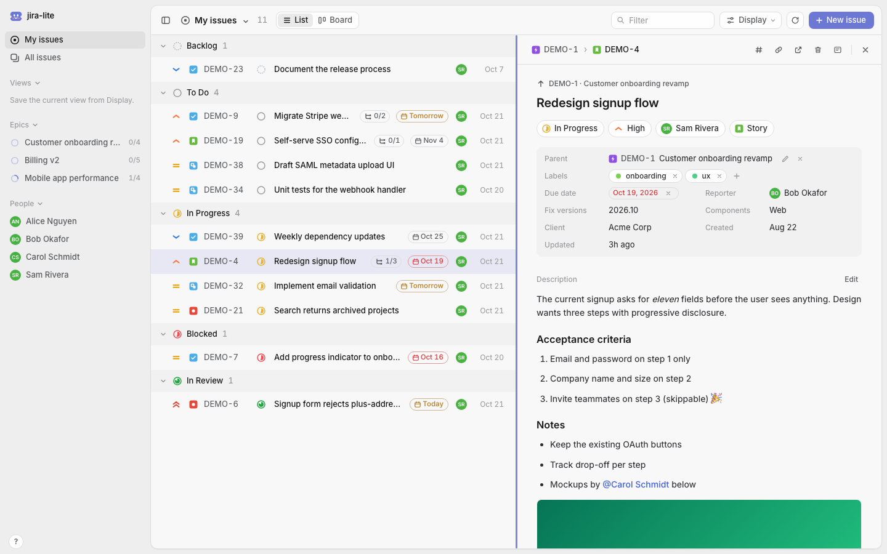
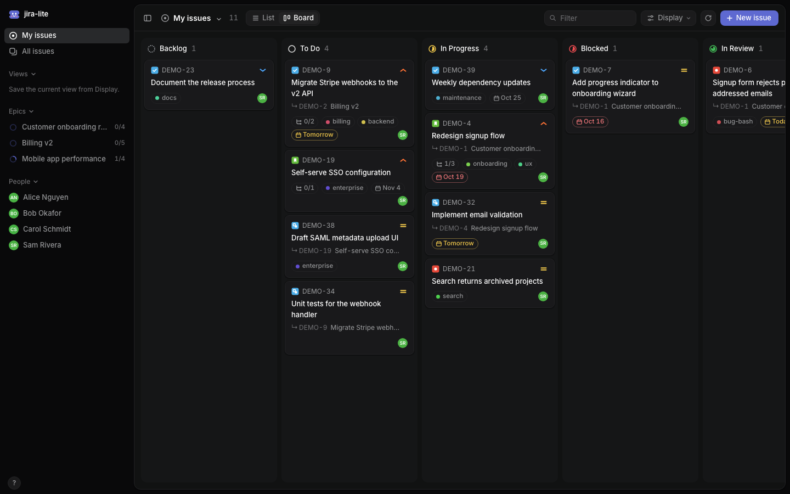
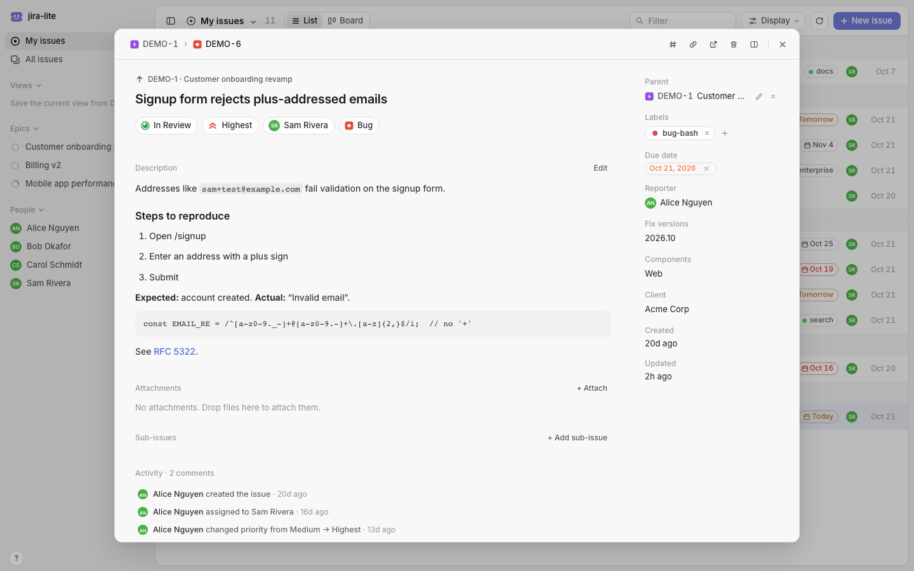
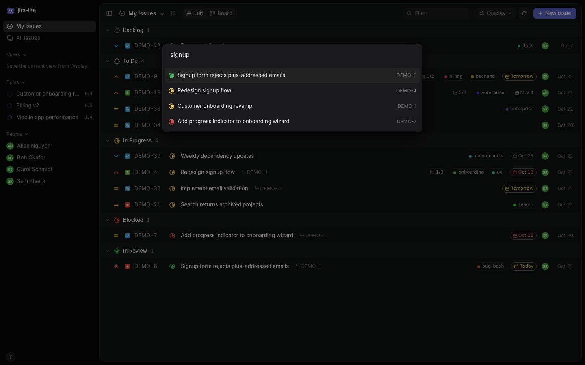

<p align="center"></p>

<h1 align="center">jira-lite</h1>

<p align="center">A fast, Linear-style web UI for Jira Cloud.</p>

It works on your real Jira through the REST API. There's no extra database and nothing to sync, and your edits land in Jira right away. It needs only Python 3.9+, with no installs and no build step. A jira-lite tab uses about 30 MB in Chrome, against about 414 MB for a Jira tab.



<table>
  <tr>
    <td></td>
    <td></td>
    <td></td>
  </tr>
  <tr>
    <td align="center">Board: drag to change status</td>
    <td align="center">Issue as a dialog</td>
    <td align="center">⌘K: search and commands</td>
  </tr>
</table>

<sub>Screenshots use the built-in demo data, not a real Jira site.</sub>

## Features

- **List and board** (`⌘B`): group by status, assignee, priority or component. Drag cards to change status.
- **Issue panel or dialog**: description, properties, sub-issues, attachments, comments and history. Tickets you opened recently reopen instantly.
- **Edit in place**: title, status `s`, priority `p`, assignee `a`, type, labels, due date, versions, components and required custom fields.
- **Markdown descriptions**: paste or drop screenshots straight in. Content Markdown can't express (tables with merged cells, panels…) is kept as is.
- **Create issues** (`c`): includes the fields your project requires, and sub-issues inherit them from the parent.
- **Comments**: add, edit and delete your own.
- **Command menu** (`⌘K`): search the whole project, jump to a key, run any command.
- **Keyboard first**: `j`/`k` move, `Enter` opens, `Esc` closes, `/` filters, `?` lists every shortcut.
- **Stays current**: refreshes every 60 s, fetching only what changed.
- Light and dark themes follow your system, and the layout works on phones.

## Setup: just you

1. Create an API token at https://id.atlassian.com/manage-profile/security/api-tokens (**Create API token**, not the scoped kind).
2. `cp .env.example .env`, then fill in `JIRA_SITE`, `JIRA_EMAIL`, `JIRA_TOKEN` and `JIRA_PROJECT`.
3. Run `make run` and open http://localhost:8765.

The server listens only on `localhost`, because every request uses your token.

## Setup: a team (Sign in with Atlassian)

Each person signs in with their own Atlassian account, so their actions are under their name and limited to their own Jira permissions.

1. **Register an app** at https://developer.atlassian.com/console/myapps/ → **Create** → **OAuth 2.0 integration**:
   - Permissions → Jira API → `read:jira-work`, `write:jira-work`, `read:jira-user`
   - Authorization → callback `https://<server-address>:8765/oauth/callback`
   - Distribution → turn on **Sharing**
2. **Make a certificate**: `make cert HOSTS="192.168.1.20 my-server.local"`
3. **Fill in `.env`** on the server:
   ```sh
   JIRA_SITE=https://your-site.atlassian.net
   JIRA_PROJECT=BA
   ATLASSIAN_CLIENT_ID=...
   ATLASSIAN_CLIENT_SECRET=...
   JIRA_LITE_BASE_URL=https://192.168.1.20:8765   # same origin as the callback
   JIRA_LITE_TLS_CERT=certs/server.crt
   JIRA_LITE_TLS_KEY=certs/server.key
   JIRA_LITE_PUBLIC_HOSTS=192.168.1.20,my-server.local
   JIRA_LITE_BIND=0.0.0.0
   ```
4. **Run** `make run` and share the link. Each colleague trusts `certs/ca.crt` once (macOS: Keychain Access → *Always Trust*; Windows: *Trusted Root Certification Authorities*), then clicks **Sign in with Atlassian**.

Restarting the server signs everyone out. If colleagues see "not allowed" when signing in, your Atlassian admin is blocking user-installed apps.

<sub>The look follows Linear: the palette comes from Linear's public theme generator and every icon is inline SVG. No Linear code or assets are included.</sub>
